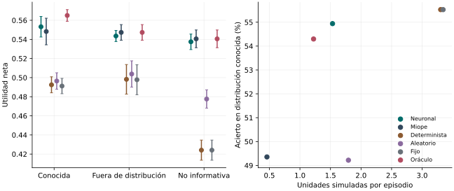

# HANA Fundamental Research Fase 2

Prototipo de Zaskar para Hikari Yumiko. Evalúa un selector neuronal de
operaciones en un problema sintético de adquisición de evidencia. La
contribución observada es una prueba controlada, no una arquitectura inédita.

- [Formulación, supuestos y antecedentes](formulacion.md)
- [Resultados, dispersión y mediciones](resultados.md)
- [Datos por semilla](results/)
- [Pruebas de la interfaz de memoria](test_environment.py)



**Figura 1.** Izquierda: utilidad media y desviación estándar de cinco
semillas. Derecha: acierto frente a unidades de costo simuladas, en
distribución conocida. Unidades presupuestarias y latencia son magnitudes
distintas.

## Resultado principal

En distribución conocida, el selector obtuvo 54,94 % de acierto frente
a 49,36 % de la regla miope. Gastó 1,533 frente a 0,460 unidades y
requirió 28,69 frente a 23,19 µs de latencia mediana. La diferencia
emparejada de utilidad fue +0,0050, con IC del 95 % de −0,0102 a +0,0201.
El intervalo exploratorio, calculado sobre cinco semillas, incluye cero.
En el conjunto fuera de distribución, la red obtuvo 47,97 % y utilidad
0,5436, frente a 50,12 % y 0,5473 de la regla miope. La red también gastó
menos allí, de modo que la menor latencia y el menor acierto corresponden
a otro punto operativo. El protocolo no demuestra dominancia ni ahorro
energético.

La red casi siempre evitó las memorias no informativas (0,070 accesos por
episodio), aunque la regla miope evitó todos. Cuando aumentó la tarifa
local, la red acertó ambos extremos en 62,18 % de los pares donde el
oráculo cambió de decisión, frente a 68,49 % de la regla miope. Retirar
costos explícitos mantuvo casi idéntica utilidad conocida y mejoró la
utilidad fuera de distribución respecto a la red completa, mientras
degradó la respuesta contrafactual. Por tanto no hay evidencia de que
incorporarlos tal como se hizo aporte una ventaja robusta. La máscara
de acciones factibles se conserva en esa ablación.

El índice tiene valor indirecto en casos comprobados por prueba: abre
una verificación útil aun cuando su ganancia inmediata sea cero. Esa
diferencia entre horizonte largo y uno es real en este simulador.
La red aproxima imperfectamente el planificador que ya dispone del
modelo de observación. Su mayor acierto conocido se compró con más
operaciones y no se trasladó a utilidad o generalización robustas.

## Qué conservar o modificar

Conservar el entorno opaco, la regla miope y el planificador exacto
como controles. Descartar la versión actual del selector como opción
preferida de ejecución. Para una revisión futura, medir primero una
política híbrida que ejecute directamente la regla miope en casos
simples y llame a un estimador residual solo cuando haya una operación
habilitadora. Comparar frentes a presupuesto o riesgo igualados,
entrenar con inversiones de tarifas y fiabilidad, y reservar una
perturbación independiente. El costo de calcular el residuo debe
entrar en la medición. Son propuestas, sin implementación posterior.

## Reproducción

Desde esta carpeta, en Linux x86-64 y Python 3.11 o posterior:

```sh
python -m pip install -r requirements.txt
OPENBLAS_NUM_THREADS=1 python -m unittest -v
mkdir -p results
for seed in 7 19 43 71 101; do
  OPENBLAS_NUM_THREADS=1 python experiment.py --seed "$seed" > "results/seed-$seed.json"
done
python -m pip install matplotlib==3.10.6
python report.py
```

Cada semilla genera 1 200 perfiles de entrenamiento y 200 de validación,
con 1 800 pasos por red y 1 024 episodios en cada escenario. Se inicializan
tres redes desde cero por semilla. Las políticas comparten los mismos
mundos y resultados preasignados a cada fuente. La matriz de GitHub
Actions publica un JSON por semilla. Las cifras temporales se obtuvieron
localmente y pueden cambiar con la máquina. El RSS es por proceso,
incluye entrenamiento y no permite asignar RAM aislada a cada política.
