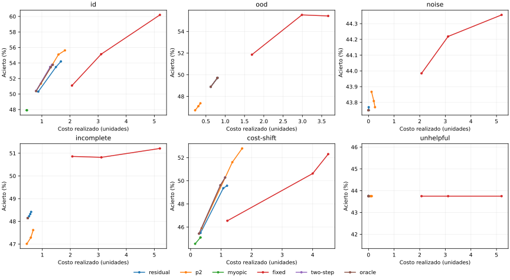

# HANA Fundamental Research Fase 3

Investigación de Zaskar para Hikari Yumiko. Se reprodujo la Fase 2 antes
de probar un predictor del valor adicional de un horizonte más largo.
El selector residual conserva la regla miope como base analítica.

- [Método, formulación y reproducción](metodologia.md)
- [Resultados agregados e intervalos](resultados.md)
- [Resultados y diagnósticos por semilla](results/)
- [Reproducción de la Fase 2 por semilla](reproduction/)



Los puntos de cada curva corresponden a los presupuestos 3, 5 y 7.
Las tarifas representan unidades simuladas, mientras que las latencias
se midieron en CPU.

## Hallazgos e interpretación

**Reproducción y causa del costo.** En los perfiles originales ID el
selector de Fase 2 realizó 984,2 adquisiciones por cada 1 024 episodios
frente a 279,4 de la regla miope. No todo ese gasto fue un error.
Habilitó accesos cuyo valor existe solo al considerar un horizonte más
largo. Entre sus adquisiciones, el oráculo consideró innecesarias en
promedio 92,8 lecturas locales, 85,0 consultas de índice y 19,4
verificaciones. La regla miope evitó adquisiciones dominadas, pero
terminó prematuramente 231,6 veces según el horizonte tres. En OOD
original el patrón se invirtió: Fase 2 hizo 129,0 adquisiciones frente
a 293,2 de la regla miope y se detuvo prematuramente 178,4 veces.
Se observa desajuste de decisiones bajo cambios de tarifas, fidelidad
y omisión. No se identifica una causa única del OOD conjunto.

**Comparación primaria.** En ID con presupuesto 5, el residual obtuvo
53,48 % de acierto y utilidad 0,5467 frente a 47,91 % y 0,5347 de la
regla miope. La diferencia emparejada de utilidad fue +0,0120,
IC del 95 % [0,0038, 0,0203]. Usó 1,499 unidades frente a 0,465 y
34,02 µs frente a 23,18 µs. La política exacta de dos pasos obtuvo
53,50 %, utilidad 0,5543 y costo 1,295, pero fue más lenta, con
51,45 µs. Frente a Fase 2 el residual gastó un poco menos (1,499
frente a 1,592), perdió acierto (53,48 % frente a 55,10 %) y tuvo
más latencia (34,02 frente a 26,24 µs). La diferencia de utilidad
frente a Fase 2 fue −0,0050, IC [−0,0180, 0,0079]. La red más
pequeña no compensa el cálculo miope adicional en latencia ID.

**Generalización y ablaciones.** Para OOD con presupuesto 5 el
residual igualó las decisiones del miope en utilidad, precisión y
costo agregados, y mejoró el acierto frente a Fase 2 en 2,62 puntos
(IC [1,40, 3,83]). Frente a Fase 2, la diferencia OOD de utilidad
fue +0,0063, IC [−0,0004, 0,0129]. En ruido, omisión y memorias
no informativas evitó gran parte del gasto improductivo de Fase 2.
Todavía sobreevalúa el índice, con 129,2 índices dominados por
parar en ID a presupuesto 5 frente a 100,0 de Fase 2. En el
contrafactual de tarifa acertó ambos extremos en 65,5 % de los
pares relevantes, frente a 43,7 % de Fase 2, 60,3 % del miope y
88,6 % del control de dos pasos. Quitar la puerta cambió
poco la utilidad y no produjo un ahorro claro en ID. Quitar costos
explícitos no elimina el acceso indirecto mediante la regla base.

**Decisión.** Conservar el residual como referencia experimental y
descartar la afirmación de eficiencia global para esta implementación.
El problema no es aprender cualquier corrección: es evitar correcciones
positivas espurias para operadores habilitadores sin perderlas cuando
son útiles. Un filtro que prediga ventaja con margen frente a parar,
o una aproximación al control exacto de dos pasos con costo explícito
de inferencia, sigue siendo una propuesta para revisión. El resultado
no justifica sustituir los controles. No se midieron julios. La Fase 4
requiere autorización.

## Reproducción

Usar Python 3.11 o posterior en Linux y un hilo de OpenBLAS:

```sh
cd research/fundamental-phase-3
python -m pip install -r ../fundamental-phase-2/requirements.txt
export OPENBLAS_NUM_THREADS=1 OMP_NUM_THREADS=1
python -m unittest -v
python verify_repro.py reproduction/seed-*.json
for seed in 7 19 43 71 101; do
  python experiment.py --seed "$seed" > "results/seed-$seed.json"
done
python -m pip install matplotlib==3.10.6
python report.py
```

GitHub Actions reejecuta la reproducción de Fase 2 y la matriz nueva,
y publica ambos JSON por semilla. Las métricas temporales y RSS se
registran por separado de los resultados deterministas.
